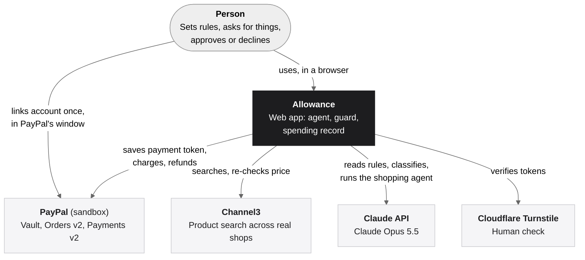
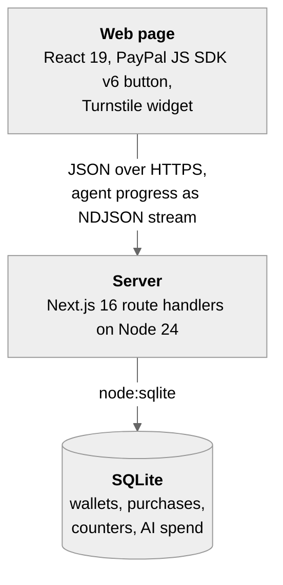
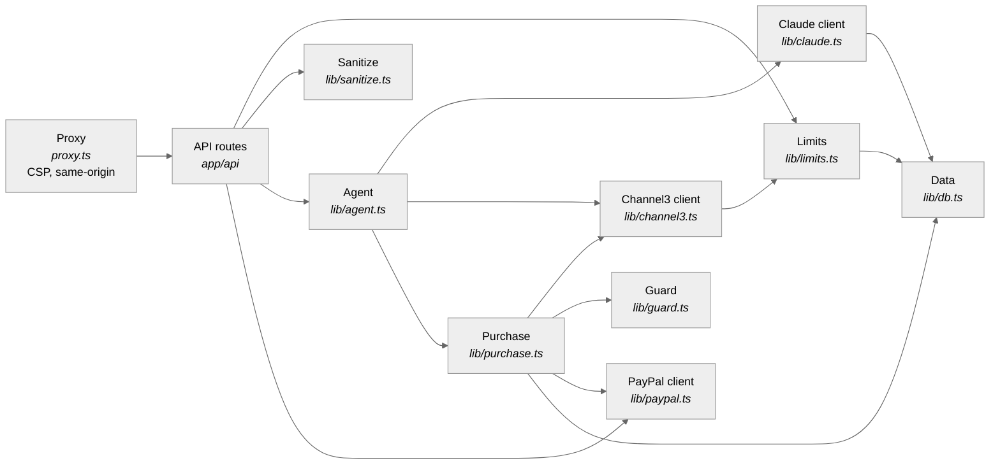
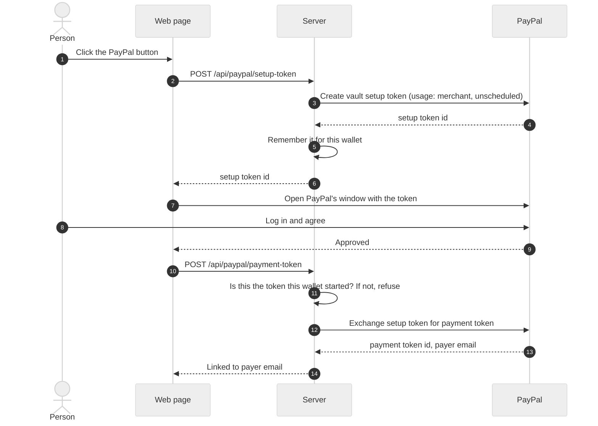
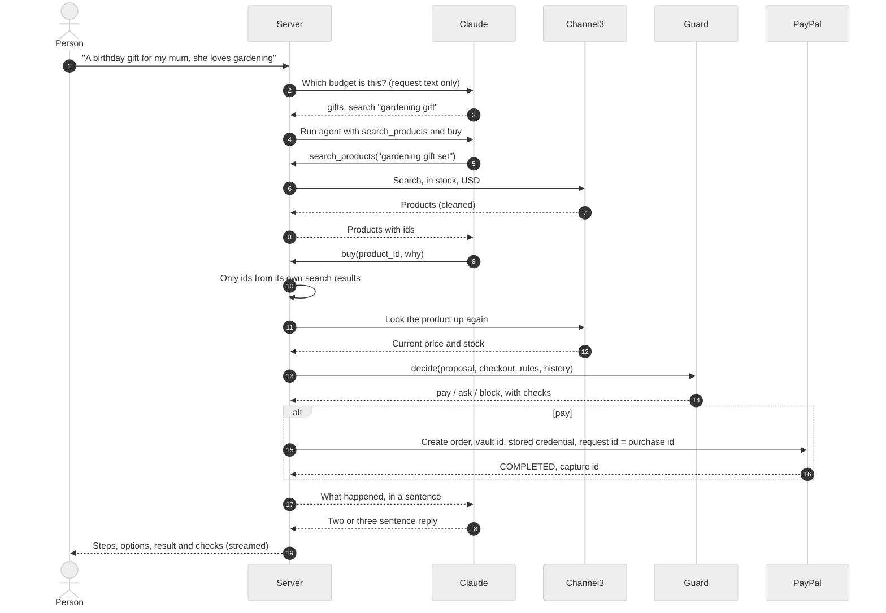
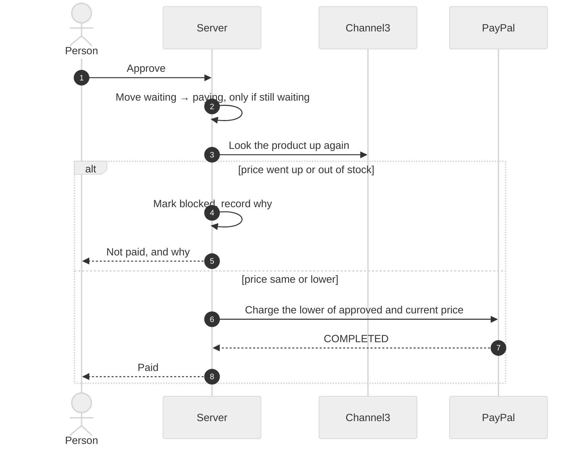
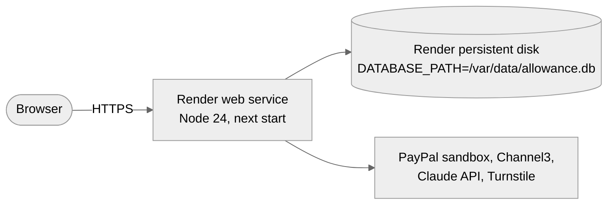
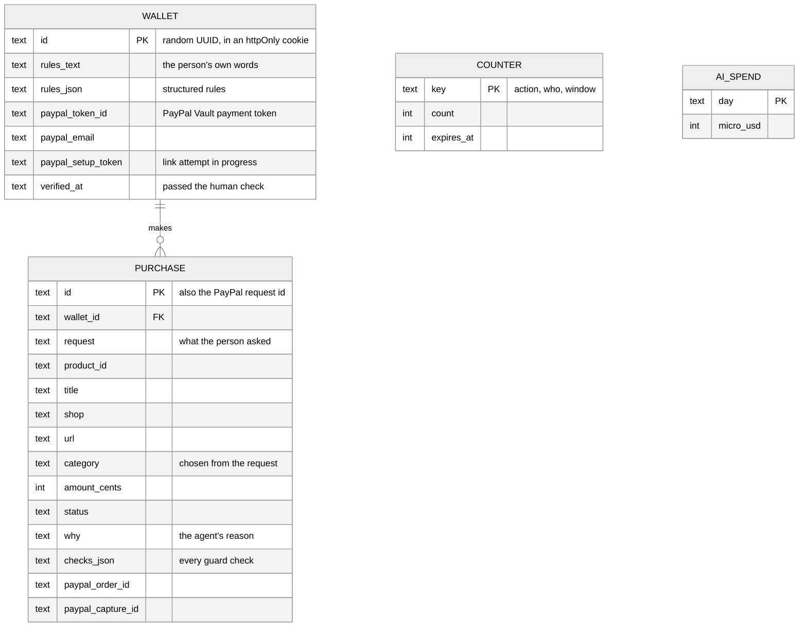
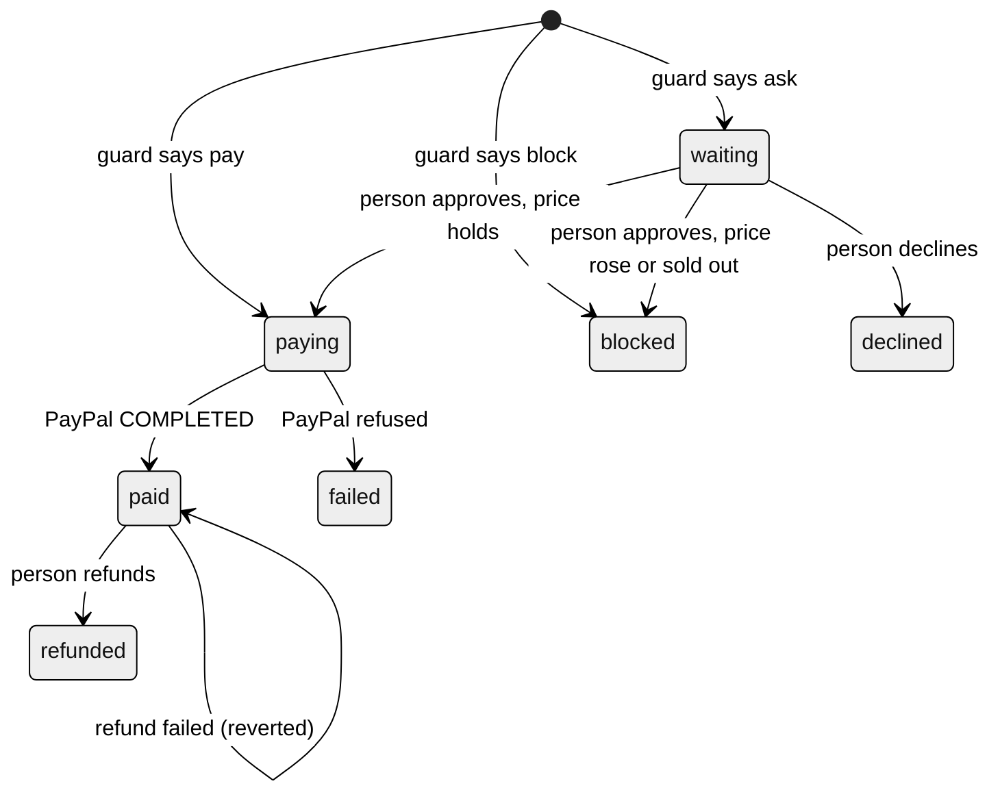

# Architecture

This document follows the [arc42](https://arc42.org) template, trimmed to the sections that carry weight for a project this size. Diagrams use the [C4 model](https://c4model.com)'s levels (context, containers, components), drawn in Mermaid so GitHub renders them.

## 1. Goals

Allowance lets an AI agent buy things with a person's PayPal account, but only within rules the person set in plain words. See [concept.md](concept.md) for the problem and the people it's for.

Quality goals, in priority order:

| # | Goal | What it means here |
| --- | --- | --- |
| 1 | Money safety | No payment happens unless code, not the model, decided it should. No double charges. |
| 2 | Correct decisions | Budgets, limits and price checks are exact, in integer cents, and tested. |
| 3 | Explainability | Every decision is recorded with the checks that led to it, in plain sentences. |
| 4 | Cost control | A public demo can't run up unbounded AI, search or payment API usage. |
| 5 | Simplicity | One process, one database file, few moving parts. |

## 2. Constraints

- PayPal **sandbox** only (hackathon rule). No real money moves.
- The hosted demo must stay up and free to use until judging ends (15 Dec 2026).
- Channel3's free plan: 1,000 API calls a month.
- One developer, about ten days.

## 3. Context

## 4. Solution strategy

| Problem | Approach |
| --- | --- |
| The model could be wrong or manipulated | **The model proposes, code decides.** The model has two tools, `search_products` and `buy(product_id)`. It has no payment tool. [lib/guard.ts](../lib/guard.ts) decides pay, ask or block. ([ADR 0001](decisions/0001-model-proposes-code-decides.md)) |
| The agent has to pay while the person is away | **PayPal Vault** saves the person's PayPal as a payment token; charges are merchant-initiated Orders v2 calls that complete in one request. ([ADR 0002](decisions/0002-paypal-vault-merchant-initiated-payments.md)) |
| A product page could try to change the budget | **The budget is chosen from the person's words before any product is read.** ([ADR 0004](decisions/0004-budget-before-product-data.md)) |
| Prices change | **Look again before money moves**, both for automatic purchases and when the person approves later. ([ADR 0005](decisions/0005-recheck-before-paying.md)) |
| A public demo can be abused | **Limits per wallet and per IP, global cost caps, and a human check**, all counted in the same database. ([ADR 0007](decisions/0007-limits-and-cost-caps.md), [ADR 0008](decisions/0008-human-check.md)) |
| Keep it small | **One Next.js process and SQLite built into Node.** ([ADR 0006](decisions/0006-sqlite-in-node.md)) |

## 5. Building blocks

### Containers

### Components (inside the server)

| Component | File | Responsibility |
| --- | --- | --- |
| Proxy | [proxy.ts](../proxy.ts) | Per-request Content Security Policy with a nonce; refuses API writes from other origins |
| API routes | [app/api](../app/api) | Validate input, apply limits, call the domain code, return the page's state |
| Agent | [lib/agent.ts](../lib/agent.ts) | Runs Claude with two tools; only lets it buy products it found itself |
| Purchase | [lib/purchase.ts](../lib/purchase.ts) | Second look at the shop, guard decision, record, PayPal charge |
| Guard | [lib/guard.ts](../lib/guard.ts) | Pure function: proposal + checkout + rules + history → pay / ask / block with reasons |
| Claude client | [lib/claude.ts](../lib/claude.ts) | Parses rules, classifies requests, records token cost, enforces the daily AI budget |
| Channel3 client | [lib/channel3.ts](../lib/channel3.ts) | Search and lookup; cleans every field a shop wrote |
| PayPal client | [lib/paypal.ts](../lib/paypal.ts) | Vault setup and payment tokens, merchant-initiated orders, refunds |
| Limits | [lib/limits.ts](../lib/limits.ts) | Rate limits, quotas and the Channel3 monthly cap |
| Sanitize | [lib/sanitize.ts](../lib/sanitize.ts) | Removes control, zero-width and direction-override characters; https-only links |
| Data | [lib/db.ts](../lib/db.ts) | SQLite schema and queries; atomic status changes |

## 6. Runtime

### Linking PayPal

### Asking for something

### Approving a purchase that waited

## 7. Deployment

Planned for the hosted demo:

Secrets are set as Render environment variables, never in the repository. A single instance keeps the in-process "one agent run per wallet" lock and the SQLite counters exact.

## 8. Crosscutting concepts

### Data

### Purchase lifecycle

Every move out of a state is a single `UPDATE … WHERE status = ?`, so two taps, two tabs or a retry can't take the same path twice.

### Money

Amounts are integer cents everywhere past the edges. The guard compares cents; PayPal receives a string with two decimals. Only US dollars are accepted.

### Errors

Errors meant for the person (`UserError`, `LimitReached`) carry their own message and HTTP status. Anything else is logged on the server and replaced with a general message, so internal details never reach the browser.

### Idempotency

The purchase id is sent to PayPal as `PayPal-Request-Id`. PayPal returns the same order for the same id, so a retry after a timeout cannot charge twice. Verified against the sandbox: see [testing.md](testing.md#manual-tests-against-the-sandbox).

## 9. Decisions

See [decisions/](decisions/README.md).

## 10. Quality scenarios

| Scenario | Expected response | Where |
| --- | --- | --- |
| A product page tells the agent the item is pre-approved | The guard still asks the person; no charge | `tests/purchase.test.ts` |
| The price rises between search and payment | Blocked, with old and new price | `tests/guard.test.ts`, `tests/purchase.test.ts` |
| The person taps Approve twice | One charge; the second tap gets "already dealt with" | `claimStatus` in `lib/db.ts` |
| The PayPal call times out and is retried | Same order returned; one charge | Manual sandbox test |
| Someone scripts the ask endpoint | Limited per wallet, per IP, and by the daily AI budget | `tests/limits.test.ts` |
| Claude calls `buy` twice in one turn | Only the first counts | `lib/agent.ts` |

## 11. Risks and technical debt

| Risk | Current state | Next step |
| --- | --- | --- |
| A server crash between "paying" and PayPal's answer leaves a purchase stuck in `paying` | Rare; the PayPal request id makes a retry safe | A start-up job that asks PayPal about `paying` orders and settles them |
| Wallets live in a cookie, with no account | Fine for a demo; losing the cookie loses the wallet | Sign-in, so a wallet can be shared across devices |
| The agent lock is in memory | Correct for one instance | Move it to the database if the app ever runs on several instances |
| Classification is done by the model | A misread category falls back to "ask" when no rule covers it | Let the person correct the category on the result |

## 12. Glossary

| Term | Meaning |
| --- | --- |
| Wallet | One person's allowance: their rules, linked PayPal and purchases |
| Guard | The plain-code check that decides pay, ask or block |
| Vault | PayPal's service for saving a payment method for later charges |
| Setup token / payment token | PayPal Vault's two steps: a token the buyer approves, then a long-lived token to charge |
| Merchant-initiated | A charge made by the merchant without the buyer present, using a saved payment token |
| Turnstile | Cloudflare's check that a visitor is a person |
