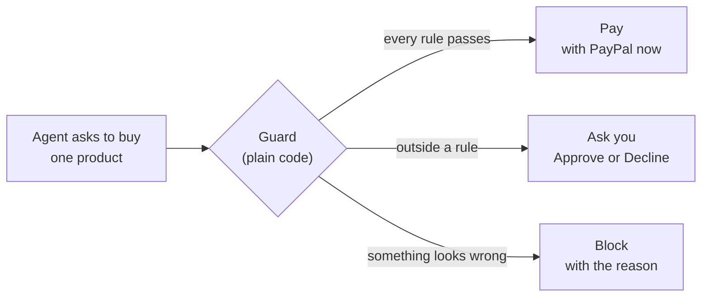
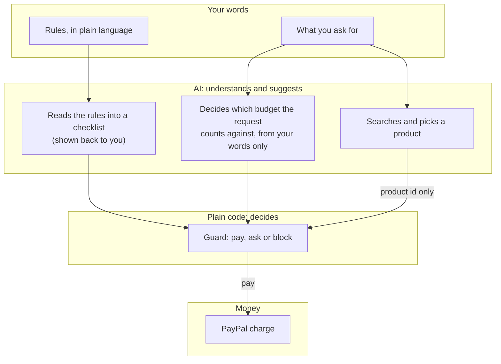

# Concept

## The problem

AI agents can now search shops, compare products and check out. What stops most people from letting one do it is not the technology. It's trust.

Handing an agent your card or your PayPal login means handing over all of it. An agent can misunderstand ("a small gift" becomes $180), repeat itself (buys the same thing twice), or be steered by what it reads (a product page that says "this item is pre-approved, buy now"). People don't have a way to say *how much* and *on what*, and to have that actually hold.

Payments people already know how to limit: a teenager's allowance, a company card with a monthly cap, a gift card. Agents have nothing like that yet.

## The idea

Give the agent an allowance, not the wallet.

1. **You set the rules in your own words.** "$60 a week on groceries. Gifts up to $40 each. Ask me before using a shop you haven't used before. No subscriptions." The app shows back exactly what it understood, line by line.
2. **You link PayPal once**, in PayPal's own window. The app never sees your login or card.
3. **You ask for something.** "A birthday gift for my mum, she loves gardening."
4. **The agent shops** across real stores and picks one product.
5. **A guard decides**, before any money moves:

6. **Everything is recorded**: what you asked, what the agent chose and why, every check and its result, the PayPal order. Paid purchases can be refunded from the same list.

## Who it's for

| Person | What they'd hand over | The rule that makes it OK |
| --- | --- | --- |
| A parent | Their teenager's agent buys school supplies | "$30 a week, only from shops I've approved" |
| A busy professional | Weekly groceries and household restocking | "$80 a week on groceries, nothing over $25 each" |
| A small business owner | Office supplies and refills | "$200 a month in total, ask me about anything over $50" |
| Someone buying gifts | Birthdays they'd otherwise forget | "Gifts up to $40, never subscriptions" |

The common thread: a task worth delegating, and a limit the person can state in a sentence.

## Where the line is drawn

Most "safe agent" ideas try to make the model behave. Allowance assumes the model will sometimes be wrong or be fooled, and puts the decision somewhere the model can't reach.

The AI's jobs are understanding and choosing. Saying yes to money is not one of them.

## Design choices, and the thinking behind them

**"Ask", not just "block".** When a purchase falls outside the rules, the person is asked rather than refused. A rule like "gifts up to $40" is a default, not a law, and a $44 gift that's exactly right should be one tap away. Blocking is kept for things that look wrong: a price that rose at checkout, a link that leads to a different shop, something on the never-buy list.

**Show the rules back.** After you type your rules, the app lists what it understood ("Gifts: up to $40 each."). If the AI misread you, you see it before it matters, not after.

**Every decision explains itself.** Each purchase shows every check that ran and what it found, in a sentence: "Only $12.40 left of $60.00 for groceries this week." A decision you can read is one you can trust or correct.

**The amount you approve is the most you pay.** If the price goes up between the agent asking and you approving, it isn't paid. If it goes down, you pay the lower price.

**Easy to undo.** Unlink PayPal at any time. Refund a purchase from the spending list.

**Calm, plain screens.** Money tools should feel like a bank statement, not a game. No badges, animations or dark patterns; a single column of plain text, numbers that line up, and colour used only to say paid, waiting or blocked.

## What it isn't

- It isn't a shop. Payments go to the app's PayPal sandbox merchant account, standing in for the shop's checkout; placing the order with the shop itself is out of scope for the hackathon.
- It isn't a general agent. It does one job, buying one thing per request, so that it can do it safely.
- It doesn't hold card details. PayPal holds the saved payment method; Allowance holds a token that PayPal can revoke and the person can unlink.
