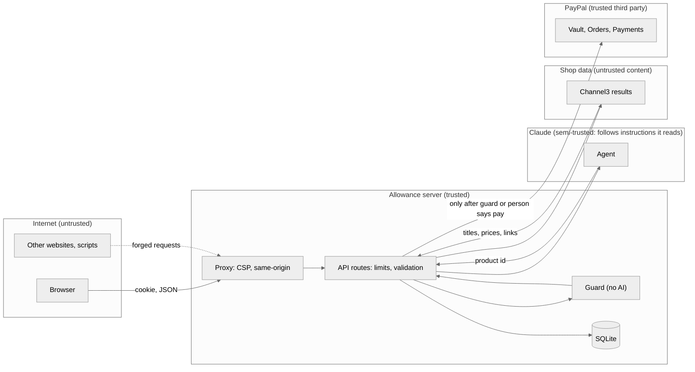

# Security and threat model

Allowance moves money on a person's behalf, guided by an AI that reads text written by strangers. This document is the threat model. It follows Adam Shostack's four questions, uses STRIDE to find threats, and maps the controls to three OWASP lists:

- [OWASP Top 10:2025](https://owasp.org/Top10/2025/) (web applications)
- [OWASP Top 10 for LLM Applications 2025](https://genai.owasp.org/llm-top-10/)
- [OWASP Top 10 for Agentic Applications 2026](https://genai.owasp.org/resource/owasp-top-10-for-agentic-applications-for-2026/)

Last reviewed: 4 November 2026.

## 1. What are we working on?

A web app where a person sets spending rules, links PayPal once, and asks an AI agent to buy things. The agent searches products and proposes one purchase; plain code decides whether it's paid, sent to the person for approval, or blocked. Architecture: [architecture.md](architecture.md).

### Assets

| Asset | Why it matters |
| --- | --- |
| The saved PayPal payment token | Lets the server charge the person's PayPal account |
| The person's money | The thing being protected |
| Spending rules and history | Decide what the agent may do; reveal what someone buys |
| API keys (PayPal, Claude, Channel3, Turnstile) | Cost money or move money if leaked |
| The service's budget (AI, search) | A public demo can be drained |

### Data flow and trust boundaries

The key boundary is between the model and the guard. Everything the model produces is treated as a suggestion, and everything a shop wrote is treated as untrusted text.

## 2. What can go wrong?

STRIDE, applied to the parts above.

| # | Category | Threat | Where |
| --- | --- | --- | --- |
| T1 | Spoofing | Someone uses another person's wallet by guessing or stealing the cookie | Session |
| T2 | Spoofing | A product link claims to be one shop but leads to another | Shop data |
| T3 | Spoofing | An attacker attaches their own PayPal approval to someone else's wallet | Linking |
| T4 | Tampering | A product page tells the agent to ignore the rules or that the item is pre-approved | Agent |
| T5 | Tampering | A product presents itself as a different category to use a bigger budget | Agent |
| T6 | Tampering | The price rises between search and payment | Shop data |
| T7 | Tampering | Another website makes the person's browser call the API | API |
| T8 | Tampering | Hidden characters make text read differently to people and to the model | All text |
| T9 | Repudiation | A charge happens and nobody can say why | Purchases |
| T10 | Information disclosure | Error messages leak internals; keys end up in the repository | API, repo |
| T11 | Information disclosure | Personal data is sent to the AI provider | Agent |
| T12 | Denial of service | A script drains the AI budget or the Channel3 quota | API |
| T13 | Denial of service | The agent loops without end | Agent |
| T14 | Elevation of privilege | The model calls a payment directly, or buys more than once | Agent |
| T15 | Elevation of privilege | A double tap or retry pays twice | Payments |
| T16 | Elevation of privilege | Injected script runs on the page | Browser |

## 3. What are we going to do about it?

| Threat | Controls | Code |
| --- | --- | --- |
| T1 | Wallet id is a random UUID v4 in an `HttpOnly`, `SameSite=Lax`, `Secure` (in production) cookie; only valid, existing ids are accepted; every purchase lookup is scoped to the wallet | [lib/session.ts](../lib/session.ts), [lib/db.ts](../lib/db.ts) |
| T2 | The link must be https and its host must equal the shop or be a subdomain of it; look-alike characters are folded before comparing | [lib/guard.ts](../lib/guard.ts), [lib/sanitize.ts](../lib/sanitize.ts) |
| T3 | The setup token is stored per wallet when created; the exchange only accepts that token | [app/api/paypal](../app/api/paypal) |
| T4 | The model has no payment tool; the guard decides from data, not text; the system prompt marks shop text as information, never instructions | [lib/agent.ts](../lib/agent.ts), [lib/purchase.ts](../lib/purchase.ts) |
| T5 | The category is chosen from the person's request before any product data is read | [lib/claude.ts](../lib/claude.ts) |
| T6 | Price and stock are looked up again right before paying, and again when a waiting purchase is approved | [lib/purchase.ts](../lib/purchase.ts), [app/api/purchases](../app/api/purchases) |
| T7 | API writes must carry an `Origin` matching the host, and `Sec-Fetch-Site` must not be `cross-site`; cookie is `SameSite=Lax` | [proxy.ts](../proxy.ts) |
| T8 | Control, zero-width and direction-override characters are removed and text is NFKC-normalised, both from people and from shops | [lib/sanitize.ts](../lib/sanitize.ts) |
| T9 | Every attempt is recorded with the request, the agent's reason, every check, and the PayPal order and capture ids | [lib/db.ts](../lib/db.ts) |
| T10 | Only messages written for people reach the browser; secrets live in environment variables; `.env` is git-ignored; GitHub secret scanning with push protection is on | [lib/http.ts](../lib/http.ts) |
| T11 | Claude receives the rules, the request and product data only. No PayPal token, email or payment details are sent to it | [lib/agent.ts](../lib/agent.ts) |
| T12 | Per-wallet and per-IP rate limits and daily quotas; one agent run per wallet at a time; daily Claude budget; monthly Channel3 cap; optional Turnstile check | [lib/limits.ts](../lib/limits.ts), [lib/captcha.ts](../lib/captcha.ts) |
| T13 | At most 8 agent iterations and 16,000 output tokens per run; 120-second request limit | [lib/agent.ts](../lib/agent.ts) |
| T14 | Two tools only; buy by product id from its own search results; one buy per request, locked before any await | [lib/agent.ts](../lib/agent.ts) |
| T15 | Status changes are single conditional `UPDATE`s; the purchase id is PayPal's `PayPal-Request-Id` | [lib/db.ts](../lib/db.ts), [lib/paypal.ts](../lib/paypal.ts) |
| T16 | Content Security Policy with a per-request nonce and `strict-dynamic`; React escapes all text; `frame-ancestors 'none'`, `object-src 'none'`, `base-uri 'self'` | [proxy.ts](../proxy.ts) |

Other hardening: HSTS, `X-Content-Type-Options: nosniff`, `Referrer-Policy`, a restrictive `Permissions-Policy`, no `X-Powered-By`, `Cache-Control: no-store` on the API, JSON bodies capped at 4 KB, request text length limits, parameterised SQL throughout ([next.config.ts](../next.config.ts)).

### OWASP Top 10 for Agentic Applications 2026

| Risk | How Allowance handles it |
| --- | --- |
| ASI01 Agent Goal Hijack | The goal (one product, for this request, in this budget) is fixed by code before the agent reads anything. Shop text can't change the category or the limits (T4, T5). |
| ASI02 Tool Misuse and Exploitation | Two narrow tools; `buy` takes an id from the agent's own results; one buy per request; tool inputs validated with zod. |
| ASI03 Identity and Privilege Abuse | The agent holds no credentials. The PayPal token stays on the server and is used only by the purchase code. |
| ASI04 Agentic Supply Chain Vulnerabilities | Official SDKs (PayPal, Anthropic, Channel3), a lock file, `npm ci` in CI, `npm audit` on every push, Dependabot. |
| ASI05 Unexpected Code Execution | The agent has no tool that runs code, reads files or makes arbitrary requests. |
| ASI06 Memory and Context Poisoning | No long-term agent memory. Each request starts fresh; stored purchases are never fed back into a prompt. |
| ASI07 Insecure Inter-Agent Communication | Single agent; no agent-to-agent messages. |
| ASI08 Cascading Failures | Failures stop rather than continue: an unconfirmed price sends the purchase to the person, a PayPal error records "failed" with nothing charged, and a failed refund restores the paid status. |
| ASI09 Human-Agent Trust Exploitation | The result's headline and status come from code, not from the model's words. The person sees every check, not just the agent's summary. |
| ASI10 Rogue Agents | The agent's reach ends at proposing one purchase. The person can unlink PayPal at any time; the operator can stop all AI use with the daily budget. |

### OWASP Top 10 for LLM Applications 2025

| Risk | How Allowance handles it |
| --- | --- |
| LLM01 Prompt Injection | Structural: the model can't pay, so a successful injection can at most change which in-budget item is proposed. Tested with an injected product title in `tests/purchase.test.ts`. |
| LLM02 Sensitive Information Disclosure | No payment data, email or tokens are sent to the model. |
| LLM03 Supply Chain | See ASI04. |
| LLM04 Data and Model Poisoning | No fine-tuning or retrieval store; product data is cleaned and used for one request only. |
| LLM05 Improper Output Handling | Model output is validated against schemas (rules, classification, tool inputs), cleaned, and rendered as text by React. It is never executed or put into SQL. |
| LLM06 Excessive Agency | Two tools, no payment tool, one purchase per request, guard on every purchase. |
| LLM07 System Prompt Leakage | The system prompt holds no secrets: only the person's own rules. |
| LLM08 Vector and Embedding Weaknesses | Not applicable: no embeddings or vector store. |
| LLM09 Misinformation | The agent's reply is shown alongside the guard's checks, which are the source of truth for what happened. |
| LLM10 Unbounded Consumption | Daily AI budget, per-run iteration and token limits, rate limits, quotas. |

### OWASP Top 10:2025

| Risk | How Allowance handles it |
| --- | --- |
| A01 Broken Access Control | Every query is scoped to the wallet; setup tokens are bound to the wallet that created them. |
| A02 Security Misconfiguration | Security headers and CSP on every response; internal errors are never sent to the browser. |
| A03 Software Supply Chain Failures | See ASI04. |
| A04 Cryptographic Failures | No custom cryptography; HTTPS with HSTS; ids from the platform's secure random generator. |
| A05 Injection | Parameterised SQL; React escaping; CSP; prompt injection handled by design (LLM01). |
| A06 Insecure Design | This threat model; the guard as a separate, tested decision point. |
| A07 Authentication Failures | No passwords are handled. The wallet cookie is unguessable, `HttpOnly` and `SameSite`; PayPal authenticates the payer. |
| A08 Software or Data Integrity Failures | Idempotent payments; atomic status changes; CSP stops unapproved scripts. |
| A09 Security Logging and Alerting Failures | Every purchase attempt is recorded with its reasons; server errors are logged. Alerting is not set up (see below). |
| A10 Mishandling of Exceptional Conditions | Fails closed throughout: unconfirmed price → ask; Turnstile unreachable → not verified; unknown error → general message, no state change. |

## 4. Did we do a good job?

How the controls are checked:

- **Automated tests** for the guard, the purchase path (including injected product text, spoofed links and a product claiming another budget), text cleaning and limits. They run in CI on every push. See [testing.md](testing.md).
- **Dependency audit** (`npm audit --omit=dev --audit-level=high`) in CI, plus Dependabot.
- **Manual checks against the PayPal sandbox**: merchant-initiated charge, retry with the same request id, refund.
- **Header and CSP checks** on the running app: cross-site and origin-less API writes are refused with 403; the page loads PayPal's button with no CSP violations.

### Known gaps

| Gap | Risk | Why it's accepted for now |
| --- | --- | --- |
| No user accounts; a wallet is a browser cookie | Losing the cookie loses access; anyone with the device can use it | Demo scope. Real use needs sign-in. |
| No alerting on unusual spending or errors | Problems are found by looking, not told | Demo scope; logs and the purchase record exist. |
| A crash between "paying" and PayPal's answer leaves a purchase in `paying` | The ledger can be out of date until checked | PayPal's request id makes a retry safe; reconciling is listed as a next step. |
| Product data comes from one provider | Wrong data from Channel3 would be believed | The second look at checkout limits the damage to a price no higher than shown. |
| Personal data retention isn't defined | Purchase history is kept until the database is reset | Sandbox only; no real personal data. |

Report security problems as described in [SECURITY.md](../SECURITY.md).
